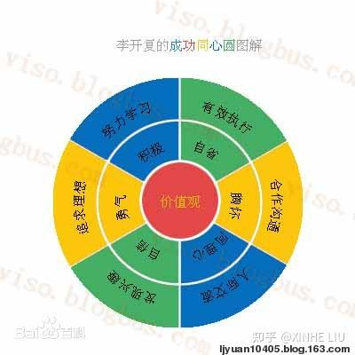
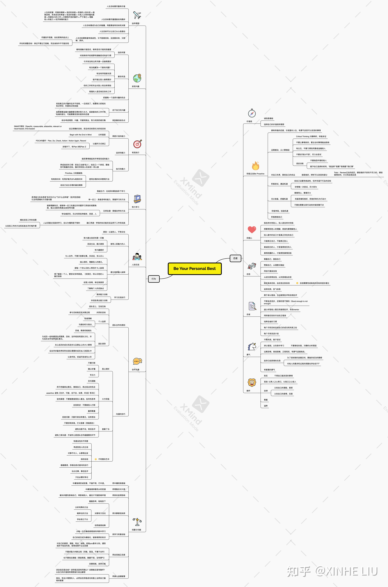

During the May Day holiday I wanted to reread this book from my university days, but could not find an e-book or reading notes online, and ChatGPT gave a summary that was complete nonsense. I bought a used copy and read it, and again felt that it is a good, forward-looking book let down by its title. Looking at its content again, much of it I only truly began to understand after starting work. Self-improvement books are all easy to know and hard to do, and far fewer people practice than read, but it is never too late to start practicing.

In this book, Kai-Fu Lee divides success into concentric circles made up of six attitudes and six behaviors. He points out that these aspects stand in a relationship of opposition and unity, and recommends using the Eastern wisdom of the Golden Mean to reach a state of completeness and balance. This combination of Eastern and Western wisdom and practical insight is something other books of this kind lack, and it is well worth consulting.

## The Concentric Circles of Success

- Diversified success
    - From the viewpoint of diversified success, there are many standards for measuring success: it can be wealth, or a person’s creativity or influence, or a person’s help or contribution to others, or a person’s improvement and surpassing of themselves.
    - The most basic standard is whether the behavior benefits society, oneself or others, and whether it lets a person keep surpassing themselves through free choice and thereby gain the greatest happiness.
    - The more developed a society is, and the more diverse its talent system and standards of success, the more each person can bring their strengths into play; the two are cause and effect of each other.
- Be your personal best
    - Let yourself gain something and improve a little every day. “Be your personal best” is the inevitable path to diversified success; only single-track success forces people to copy others’ patterns of success.
    - People who pursue their own interests and hobbies and are good at discovering and developing their own potential more easily gain fame and fortune than people pushed by parents or social pressure.
    - In the model of diversified success, as long as you choose proactively, everyone has a chance to succeed.
- The concentric circles of success
    - Values are the fundamental factor guiding attitudes and behavior.
    - Guided by the right values, one can perfect one’s character and set one’s attitude toward life straight. Attitude is the premise of action and the basic principle of dealing with people and affairs.
    - Attitude toward life shows in the most basic ways of behaving, finding the road to success through positive behavior.
    - The principle of completeness is to cultivate every aspect of oneself; the principle of balance is to take a course that is neither extreme nor biased according to one’s goals and actual circumstances, choosing the best state within the unity of opposites.
    - **Have the courage to change what can be changed, the magnanimity to accept what cannot be changed, and the wisdom to tell the two apart**

## Attitudes: Mastery Within

### Values

- Values have an immeasurable influence on a person’s behavior and life
    - There are many beautiful values—“integrity,” “kindness,” “benevolence,” “courage,” “freedom,” “vitality,” “creativity,” “harmony,” “equality,” “uprightness”—and each person can pick the few they consider most important.
- Kai-Fu Lee advocates “integrity” (honesty and keeping one’s word) as a part common to most people’s and companies’ values.
    - Integrity is a precondition for building long-term cooperation, a prerequisite for corporate profit, and the foundation of the information society
    - Self-disciplined integrity is more and more important in modern society

### Being Proactive

Be proactive

- Chinese culture stresses group consciousness and exalts “following the top” and “following the crowd,” ideas that subtly influence generation after generation of young people. Under the current education system, students are used to obeying the arrangements of parents and teachers everywhere, and can get help from them when problems arise, which breeds a habit of passivity. Parents and teachers are also used to taking over and designing life for their children and students, causing them to overlook their real character and interests.
- “Proactive” was introduced to the public by the psychologist Viktor Frankl. He said that even in extremely harsh environments, people still have the freedom to choose their own attitude.
- A proactive person
    - Believes they have the right to choose
    - Believes people can steer how things develop
    - Thinks independently when problems arise
    - Strives forward in difficulty, without blaming heaven or others
    - Believes everything depends on themselves, and that they can do better
    - Asks themselves which unimportant things they can give up in order to do the important ones

Seven steps to being proactive

1. Hold a positive attitude, face life optimistically, and have the courage to change what can be changed
2. Stay away from passivity; start from small things
    1. Do not blindly believe what people say; analyze calmly and actively verify
    2. Do not let things come to you; actively influence them
    3. Have your own opinions; do not habitually agree with or follow others
    4. Do not say “I can’t do it”; try your best
    5. Language training
        1. Do not complain about the environment or others
        2. Give yourself the right to choose: “I choose,” “I want,” “I am willing,” “I plan”
3. Take responsibility for yourself and master your own fate
    1. Make meaningful, responsible choices and actively bear the consequences
    2. Do not say “if only” or “I have to”
    3. Accept your setbacks and discern the parts you can change
4. Try actively and meet opportunities
    1. Set yourself challenging goals that are not out of reach
    2. Cherish every attempt and do your best
5. Prepare fully and seize opportunities
    1. Put heart and effort into everything
    2. Overcome hardship and setbacks and turn setbacks into drive to act
    3. Do not hesitate when you need to act immediately
6. Strive actively and create opportunities
    1. Besides being ready at all times, take the initiative to do things and create opportunities for yourself
7. Actively promote yourself
    1. Discover your strengths and be good at showing them

### Empathy

- Empathy is the ability, in interpersonal interaction, to sense others’ emotions and thoughts, understand their position and feelings, and think about and handle problems from their perspective
    - “Judging others by oneself,” “Do not do to others what you would not want done to you” (Whatever is hurtful to you, do not to any other person)
- Empathy is the foundation of interpersonal interaction
    - Empathy is the foundation of trust, and trust is the foundation of interpersonal interaction

Six points

- How I treat others is how others treat me
- To be understood by others, first understand others
    - When others express opinions, understand their position and feelings, and also find ways to let them know you have fully understood their thinking
    - If the other person is wrong, arbitrary negation is far less effective than guiding them to see their own error from their own position
    - The value of understanding
        - Adds knowledge
        - Adds persuasiveness
        - Broadens the mind
        - Wins buy-in (sincerity)
    - How to understand others better?
        - Start from caring about others and being considerate of them
        - Actively reflect on yourself
- **The self in others’ eyes is the self that truly exists**
    - One person’s understanding of another is made more by intuition than by thought, and such judgments are often fairly accurate
    - Even if what others see reflects only your performance in some respect, it is real and credible
- **You can only correct yourself, not others**
    - If you are misunderstood, do not blame the audience; you are the one conveying the message
- Honest and candid people are the ones worth trusting
    - Not minding letting others know your shortcomings and motives makes it easier to win their trust
    - **Match words with deeds; a promise is worth a thousand pieces of gold; do what you say**
    - Frankly admit your mistakes and apologize for them
- People who show genuine feeling receive genuine feeling in return
    - Open your heart as much as possible and say what is in it

### Confidence

- Confidence is fully believing in yourself on the basis of knowing yourself, **believing you can release your potential in the face of difficulties and challenges**, and believing you can go resolutely toward success driven by your ideals and interests
    - Confidence is a positive assessment of your own abilities, forming a mental state of facing hardships calmly
- Confidence comes from the suggestion of success, and inferiority from the suggestion of failure

Six steps to gain confidence

1. Respect yourself and encourage yourself
    1. Believe you have enough potential: “Heaven gave me talents, and they must be of use”
2. Praise yourself, starting from the subconscious
    1. Repeatedly train the brain with concrete examples to believe you are trustworthy and to be proud of yourself.
3. Inspire confidence through words and deeds
    1. Treat others’ views correctly
    2. Have your own thoughts and opinions
    3. Express your thoughts
    4. Confident ways of expression
        1. “I,” “I think,” “I hope,” “I require”
        2. Eye contact, clear voice
        3. Do not let others interrupt you
        4. Refuse silence
        5. Prepare fully for expression and communication
4. Gain confidence from success; gain self-awareness from failure
    1. A growth mindset; firmly believe in your ability to do things well
    2. Do not be conceited; confidence is by no means the same as self-obsession, not allowing yourself to make mistakes, self-centeredness and losing objectivity
    3. Do not fear failure; define the worst result you cannot accept. Learn from failure and improve your awareness of the boundaries of your abilities
5. Set concrete goals and move from self-awareness to confidence
    1. Neither over-criticize yourself nor be blindly optimistic; be able to evaluate yourself objectively. Face your ability baseline honestly, and do not readily accept work beyond your abilities or set unreasonable goals
    2. Be as honest with yourself as with others; facing failure honestly earns others’ trust
    3. Goals for building confidence should be feasible and measurable
6. Play to your strengths and let yourself fly
    1. Objectively evaluate and adopt the more feasible suggestions or goals in others’ feedback
    2. Confidence and being proactive complement each other
    3. The key to confidence lies in recognizing and discovering your own strengths. Discovering strengths matters more than making up for weaknesses.

### Self-Reflection

- Dare to admit mistakes; actively accept criticism and self-criticism
    - Reflect seriously, and make sure not to make the same mistake again
    - Do not cover up mistakes; evaluate yourself objectively
    - Review and self-criticism
- Keep pursuing progress; good enough is not enough (Good enough is not enough)
- Listen humbly to others’ opinions and accept criticism; look for a mentor
    - Learn to listen
    - Correct mistakes with positive, concrete action
- Reflect seriously afterward and strive to change yourself
    - What could be done better, and what could the team do better
- Cultivate the habit of self-reflection
    - **Every month, summarize your successes and failures against your goals**
    - Have an improvement plan every month

### Courage

Courage is the power to advance bravely in the face of challenge and to accept challenges

- Do not fear failure; dare to try
    - An enterprising spirit of adventure is an expression of bravery
- Admit mistakes and learn from failure
    - Do not fear failure; analyze the causes calmly
- Stay away from fear and challenge difficulties
    - “The only thing we have to fear is fear itself”; “the only limit to our realization of tomorrow will be our doubts of today”
    - Face reality and have the courage to meet challenges.
- Dare to give up what you have already obtained
    - To seek new room for development, cast off the obstacles of success
    - Learn to say “no” to others’ demands and overly high expectations
- Courage with wisdom
    - Set aside immediate gains and losses and pursue success to the greatest extent, without falling into the dead end of extremism and foolhardiness

### Magnanimity

- Pragmatism
    - Accept the people and things you cannot change; do not blame heaven or others
    - Parents, environment (what you like vs. what you should do, difficulties, and so on), talent, experience
    - Accept yourself: do not live in others’ values; be good at discovering your own interests and strengths; treat your shortcomings and limits correctly
- Forgiveness
    - Hold yourself to the standard you hold others to, and forgive others as you forgive yourself
    - Avoid being petty and thinking in zero-sum terms
    - Tell yourself “not necessarily so,” and find the reasonableness in others
    - Tell yourself “people inevitably do,” and be considerate of the other’s situation
    - Do not be unhappy over others’ faults
- Self-discipline
    - Self-regulation, including the ability to control and adjust oneself
    - Know your potential and qualities
    - Know your feelings and attitudes (neither erupting nor suppressing them); be good at talking with yourself
- Respect
    - Respect the right to different views. “I disagree with you, but I support you”
- Cultivation
    - “With tolerance, virtue grows great; with no demands, character stands high”
    - “As heaven’s movement is vigorous, the gentleman strives constantly to strengthen himself; as earth’s condition is receptive devotion, the gentleman, with broad virtue, carries all things”
    - Grasp the relations between man and nature, man and society, and man and man; be **unmoved by honor or disgrace, indifferent to gain and loss**

## Behaviors: Influence Outward

### Pursuing Ideals

- A person with ideals and responsibilities toward themselves, their family and society more easily forms their own values. “A man need not ask what the meaning of life is, but must recognize that it is he who is being asked” (Viktor Frankl)
- Ideals are the beacon that guides life; without ideals there is no firm direction, and without direction there is no fulfilling life. Every successful person has a sense of responsibility toward their ideals and a sense of mission in life.
- Ideals come from the self and from individuality; an ideal should be the life goal best suited to oneself.

How to pursue ideals

- Life goals should be as valuable as possible
- Life goals should be as free of the shackles of fame and fortune as possible
    - The riches of life: a positive spirit > a good physique > harmonious relationships > freedom from fear and hope of future success > capacity for faith > the desire to share happiness with others > loving one’s work > an open mind toward things > strict self-discipline > the ability to understand others > the ability to secure oneself financially
- Life goals should become your own brain trust
    - Use vision to guide goals and decisions
- Life goals can move you from the bottom of your heart
    - Follow your heart
        - Close your eyes and write down the ideal that first surfaces in your mind
        - Look back: do the happiest and most fulfilling times have something in common?
        - Fifteen years from now, in a perfect state of life, what environment will you be in?
        - If you had only six months to live, what would you do?
        - Imagine yourself five years from now in your ideal state—where are you? What are you doing? Who are you with?
- Life goals should be both challenging and not detached from reality, both forward-looking and clear and concrete.
    - Open your mind as much as possible and stand on a higher starting point
    - Evaluate and adjust goals: make sure they are not so difficult that they cannot be achieved by your own means

### Discovering Interests

- Passion is the driving force and necessary precondition of success
    - “Am I willing to devote myself wholeheartedly to this goal? Will I love it the way I love a lover?”
- Interest is the spark that ignites passion
    - True passion has only one source, and that is interest. Because you chase interests you are full of passion, and because of passion you enjoy happiness
- Misunderstandings about interest
    - Over-simplified definitions: a job has different facets—curiosity, creativity, patience, foresight, liking to work with one’s hands, liking to dig into details, serving others, and so on. You need to try and find out
    - It is not designed in advance: it needs to be discovered and cultivated

Five pieces of advice

- Choose what you love
    - Experience it personally and judge with your head. Can you do the thing repeatedly, happily and successfully? Do you yearn for it? Does it always leave you feeling fulfilled?
    - Only contact allows trying, and only trying lets you find what you love most
    - Keep up the good habit of broadening your horizons and trying new things
- Love what you choose
    - **Did I do something better today than yesterday?**
    - **Did I solve a new problem?**
    - **Did I learn something new?**
    - **Can I do better than others?**
    - **Is my work and field of study helpful to others?**
    - **Do the people around me affirm my work?**
- Seize every chance to choose your interests
    - When choosing schools, majors and companies, try to ensure breadth
    - Do not pursue a graduate degree just for the sake of it
- Be loyal to your interests
    - Finding your true interest is not easy; once you find it, work hard to learn the related knowledge well and accumulate knowledge and skills
    - If following an interest requires too much effort, or the work you like has dull parts, what may need to change is your attitude
- Find the best intersection
    - Consider ideals, interests, talent and employment together, and strive to find the intersection of the four
    - A life goal is like a compass and interest is like a sail; neither can be missing

### Effective Execution

The key is execution, and execution ability includes

- The ability to plan carefully
    - Set clear goals and break the overall goal into stage goals
        - The SMART principle (Specific, measurable, attainable, relevant or result-based, time-based)
    - Analyze the gap
        - Begin with the End in Mind
    - Correct in cycles
        - The PDCAR cycle: Plan, Do, Check, Action / Action Again, Record
    - **Attack on several fronts; have a Plan B and a Plan Z**
- The perseverance to pursue
    - Hold to your direction, persist without letup, stay committed and unafraid of setbacks
    - Do not give up because of momentary difficulty when you put in effort and see no progress
    - In the thirty years before being elected president, Lincoln experienced unemployment, business failure, the death of his beloved, a nervous breakdown, failed speeches, and many lost elections (legislature, Senate, local office, vice presidency)
- The boldness to execute
    - The ability to get things started and strive to finish them
    - Form good habits: **treat yourself as an “other,” make yourself a promise, aim for measurable goals, and take it as seriously as a promise to someone else**
    - Use reasonable time-management methods: generally three elements
        - Prioritize; sort by importance and urgency
        - **Have high-efficiency time: make good use of the 20% of each day that is high-efficiency**
        - **Set yourself reasonable deadlines**

### Studying Hard

The four levels of learning

1. Practice makes perfect: learn under the guidance of teachers or courses, master the content of the textbook, and know the answers to problems
    1. Be energetic and free of distracting thoughts
    2. Balance work and rest
    3. Have rhythm and method
    4. Deliberate practice
2. Drawing inferences from one instance: have the ability to think and master methods of learning
    1. Chinese education lays a solid theoretical foundation for students but often neglects cultivating the ability to think. Students are used to passively receiving knowledge in a “teaching” mode
    2. The essence of the ability to think is “asking why more often,” “why do it this way” (critical thinking), and looking at problems in a logical way
3. Self-taught mastery: master methods of self-study
    1. Be able to understand knowledge, learn other angles of observation through asking questions and drawing inferences, and think about problems from entirely new angles
    2. Learn to do research and make full use of all kinds of media, resources and people
4. Thorough integration: the knowledge learned can be applied flexibly to work and practice
    1. What you hear you forget, what you see you remember, **what you do you truly understand.**
    2. **People must learn through practice; thinking you understand is not enough**
        1. Simulate real work scenarios
        2. Evaluate everything by the methods and standards of real work

Lifelong learning

- The knowledge of one’s youth is the most precious
- Learn the basic subjects well (mathematics, information technology, English)
- Look for your first job from the standpoint of lifelong learning
    - It helps you keep learning (a good training environment and good colleagues)
    - Better opportunities for development five years later
    - It matches or helps you understand your interests and ideals

### Interpersonal Communication

Principle: treat people sincerely and interact as equals

- Do not think yourself supreme; be modest and forbearing
    - Do not think in terms of “should”; look at yourself and others objectively
- Do not compete zero-sum; progress together
    - The theme of interpersonal relationships is not how to gain a dominant position
- Business needs go beyond personal qualities
    - Have the habit of thinking from the company’s perspective
- Facing inequality
    - It is an indisputable fact that people differ. What matters most for a person is facing opportunities and choices
    - If your starting point is lower than others’, you must speed up rather than just complain
    - Conversely, if you give up your own opportunities and choices because of it, you are the one responsible
    - A tenacious, optimistic and positive spirit can infect everyone

Be a person with interpersonal charm

- Work to build a good first impression
    - Be sincere and interested in others
    - Smile and remember others’ names
    - Listen patiently
    - Make others feel they are important to you
    - *How to Win Friends and Influence People*
- Be lively and proactive, and show your true self
    - Introverts should use their own traits and strengths (good at thinking and reflecting): introverts are good at organizing thoughts, extroverts at organizing people and things. Extroverts are good at expression, introverts at reflection
    - The principle of being proactive and outgoing
    - Prepare some common topics for people you want to get to know
    - Do not care about “face”
- Have interests and hobbies
    - Become a good friend in others’ eyes

Build a high-quality network

- Cooperate with people; do not just talk business. Talk more and meet more people
- Listen carefully and understand others’ opinions.
- Ask everyone you know to help expand your network
- To learn about someone, try several channels. (Look up their résumé, talk to people who know them, and so on)
- Manage your network and ensure high quality
    - Know each person’s strengths and weaknesses

Learn communication skills

- Verbal communication
    - Speaking ability
        - Adjust your mindset
        - Practice more
        - Have methods
            - Take deep breaths and relax your muscles before speaking
            - Have ways to handle forgotten words and pauses while speaking: openings, interaction with the audience, and other routines
    - Elevator-pitch training
- Body language
    - Facial expressions present inner emotions

Build lifelong friendships; learn from family and friends

- “There are three kinds of beneficial friends: the upright, the forgiving, and the well-informed”
- “When three people walk together, there is bound to be a teacher among them”; learn from others’ experience and from your own accumulation
- Have channels for confiding and exchange

### Cooperation and Communication

Principles of teamwork

- The team comes first; mutual trust and mutual help
    - Personal interest cannot override team interest
    - Build trust. Members can honestly share their worries, weaknesses, motives, risks and goals
    - Have a sense of responsibility and hold each other accountable
- Shared goals
    - Let members take part in choosing and setting goals
    - Have a clear accountability mechanism (who is responsible for which part, and how their work is measured)
- Personal qualities
    - Be honest, and communicate with members without defenses. Debate important matters passionately, and be willing to point out each other’s problems to reach team goals
    - Be able to admit mistakes and confess your weaknesses
    - Identify with “the team comes first,” hold firm convictions, and believe teamwork is the source of strength
    - Share your ideas and acknowledge others’ contributions
- Team leadership
    - Soul, coach and cheerleader
    - Build the team’s vision, goals, operating plan and culture together with members, and cultivate team awareness in cooperation with them
    - Care about members’ growth and progress and the big and small matters of their careers
    - Seek out the best members who fit the team’s needs to join the team
    - Lead by example, be honest and open, and take the lead

Cooperation cannot do without communication; secrets of effective communication

- Listen attentively
    - Do not interrupt the other person
    - Confirm you have understood what they meant
    - Be focused and sincere
    - Convey feedback through expressions, body language or brief affirmations
    - Avoid mechanical Q&A, interrupting others, and thinking only of yourself
- Be generous and active
    - Dare to seize chances to express opinions, promote yourself and state your views
    - Communicate actively
        - Eye contact
        - Be assertive: avoid words like “maybe,” “perhaps,” “would it,” “if,” “I heard”
        - Stand by the truth: do not casually accept others’ views; think critically
        - Express yourself with confidence: do not be interrupted by others
        - Win respect: do not worry that the audience will not respect you; be someone worthy of respect
    - **Refuse silence: silence means no opinion and no ideas**
- Be direct
    - Do not beat around the bush or play tai chi (hinting indirectly)
    - Avoid saying nothing to someone’s face and criticizing them behind their back
    - Avoid triangular communication: openness and candor are the most important link in teamwork
- The art of disagreeing
    - Disagree constructively
    - Consider the other’s position
    - Address the matter, not the person; start from the matter
    - Stay confident
    - Voice objections in a gentle and mild tone
        - Replace “but” with “and”
    - Lead patiently, with the skill of Socratic questioning
    - Discuss matters in public, criticize afterward
        - Praise in the open court, assign blame in private
    - Argue only when necessary
        - Criticize ideas, not specific people
        - Keep listening attentively
        - Hear every point of view before making a judgment

## Completeness and Balance

Taking any direction of the concentric circles to an extreme, one is likely to fail to meet the basic requirements in other directions

- The key is how to choose
    - **Have the courage to change what can be changed, the magnanimity to accept what cannot be changed, and the wisdom to tell the two apart**
- Reject extremes with the Golden Mean
    - The Golden Mean stresses utmost sincerity and goodness, impartiality, and walking the middle path.
        - Extreme self-reflection becomes inferiority; extreme confidence becomes arrogance
        - Extreme courage becomes foolishness; extreme magnanimity becomes weakness
        - Extreme proactivity becomes overbearingness; extreme empathy becomes blind conformity
- Oppose one-sidedness with reason
    - The Golden Mean stresses choosing the good and following it, and adaptability
        - Where you should hold firm, have a bottom line
        - On different occasions you can be flexible, considering the other’s thinking and the occasion
        - Use wisdom to handle complex situations
- Exert influence with pragmatism
    - To solve a problem, first influence yourself, then others, and only last perhaps the environment
- Master decisions with calm
    - Think carefully, put down lightly
    - Have a methodology for decisions
        - The method of weighing pros and cons
        - The method of probability theory
        - Learn to consult the many
    - Accept the results calmly
- Accumulate experience through learning
    - Learn from every correct or mistaken judgment
    - Turn your own experience into templated, callable knowledge
- Set your attitude straight through self-awareness
    - Have a basic understanding of your own qualities, potential, strengths, defects and experience. Do not readily call it failure when setbacks come, and do not be smug when you achieve something
    - Do not overrate your abilities (impetuous, rash, poor at cooperating)
    - Nor underrate your potential (timid, hesitant, lacking courage)
    - Improve weak points and play to strong ones
- Follow wisdom with a sincere heart
    - Should one be confident or reflective? Proactive or empathetic? Brave or magnanimous? Let your own values and ideals guide the answer
    - A noble person with lofty ideals will surely apply their highest wisdom on the road to positive success

Talent in an age of globalization must integrate East and West, and be a person of both virtue and ability, with virtue first.

The gap between Chinese and American culture and education

- American youth vs. Chinese youth
    - Innovative spirit vs. seeking stability and pragmatism
    - Passionate vs. persevering
    - Proactive vs. disciplined
    - Good at independent work, thinking far ahead vs. a solid theoretical foundation
    - Direct communication and argument vs. reserved, not saying outright what is on one’s mind
    - Confident vs. modest
    - Directly voicing disagreement vs. not saying no even when disagreeing

I hope everyone becomes someone with both courage and magnanimity, both reason and passion, both confident and modest, both bright and good at expression; who pursues ideals and interests, learns and executes throughout life, and understands the way of getting along with people; an internationally minded talent integrating East and West who comes to know the self through thinking, seeks truth through learning, experiences autonomy through independence, grasps time through planning, trains eloquence through expression, savors maturity through friendship, wins value through practice, draws joy from interest, and gains strength from pursuit.

Guide career and life with the value of integrity, and cultivate the six attitudes in a complete and balanced way. Guide the six behaviors with the attitudes, apply the wisdom of “choosing success,” and find and choose the road to success that suits you best.

