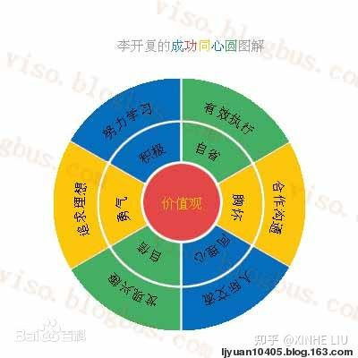
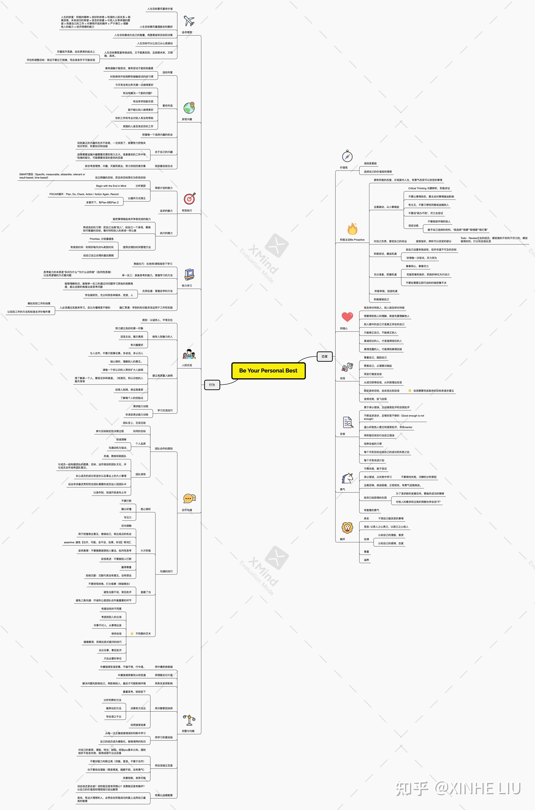

五一期间想再读这本大学学过的书，网上竟然找不到电子版和读书笔记，ChatGPT也给出了完全胡说的摘要。自己买了二手书一读，再次感慨是一本被书名耽误的好书和有前瞻性的书。而且再看其中的内容，很多是工作之后才真的开始懂的。其实自我提升的书都属于知易行难，实践远远比阅读的人少，但实践什么时候开始都不算晚。

在这本书里，李开复将成功分为了六种态度和行为构成的同心圆，他指出这些方面间具有对立统一的关系，推荐以东方中庸的智慧来达到完整和平衡的境界。这一点很有中西结合的智慧和实践的洞见，也是其他类似书籍中所没有的，非常值得参考。

在这本书里，李开复将成功分为了六种态度和行为构成的同心圆，他指出这些方面间具有对立统一的关系，推荐以东方中庸的智慧来达到完整和平衡的境界。这一点很有中西结合的智慧和实践的洞见，也是其他类似书籍中所没有的，非常值得参考

## 成功同心圆

- 多元化成功
    - 多元化成功的视角下，衡量成功的标准有很多种，可以是财富，也可以是一个人的创造力或影响力，可以是一个人对他人的帮助或者贡献，也可以是一个人在自身基础上的提高和超越。
    - 最基本的衡量标准是该行为是否对社会、自己或者他人有一，是否让一个人在自主选择的过程中不断超越自己，由此获得最大的快乐
    - 社会越发达、人才体系和成功标准越多元化，每个人更能发挥自己的特长，两者互为因果
- 做最好的自己
    - 让自己每一天都有收获和新的提高、”做最好的自己“是通过多元化成功的必然路径，只有一元化成功才会强迫人们复制他人的成功模式
    - 追逐自己的兴趣、爱好，善于发现并发掘自身潜力的人们相比迫于家长或社会的压力的人更容易获得名利和财富。
    - 在多元化成功模型中，只要主动选择，每个人都有成功的机会
- 成功同心圆
    - 价值观是指导态度和行为的根本因素
    - 有了正确价值观的引导，可以完善自己的人格，端正人生态度。态度是行动的前提，是为人处世的基本原则
    - 人生态度体现在最基本的行为方式，通过正向的行为来寻找通往成功的道路。
    - 完整的原则来培养自己的各个方面，均衡的原则是根据自己的目标和实际情况，走不偏激不极端的路线，在对立统一中选择最佳状态
    - **有勇气来改变可以改变的事情，有胸怀来接受不可改变的事情，有智慧分辨两者的不同**

## 态度：对内掌控

### 价值观

- 价值观对人的行为和生活有不可估量的影响
    - 美好的价值有很多种，”诚信”、“善良”、“仁爱”、“勇敢”、“自由”、“活力”、“创造”、“和谐”、“平等“、”正直”，每个人可以选出自己认为最重要的几项价值
- 李开复倡导“诚信”（诚实守信）是大部分人和企业价值观中共同的一部分。
    - 诚信是建立长期合作的先决条件，是企业盈利的前提、是信息社会的基础
    - 自律性诚信在现代社会越来越重要

### 积极主动Be Proactive

积极主动

- 中国文化强调群体意识，推崇“从上”“从众”，这些思想潜移默化影响者一代又一代青年。现行教育体制下，学生习惯处处听从父母和老师安排，遇到问题可以从父母和老师那里获得帮助，养成了被动的习惯。父母和老师也习惯于越俎代庖，帮助孩子和学生设计人生，导致他们忽略了真正的性格和兴趣。
- Proactive是心理学家维克托-弗兰克介绍给大众的。他说，在极端恶劣的环境里，人也会拥有选择自己态度的自由。
- 积极主动的人
    - 相信自己有选择的权利
    - 相信人可以主导事情的进展
    - 遇到问题独立思考
    - 遇到困难积极进取，不怨天尤人。
    - 相信一切靠自己，自己可以做的更好。
    - 问自己可以放弃哪些不重要的事，做重要的事

积极主动的7步

1. 拥有积极的态度，乐观面对人生，有勇气改变可以改变的事情
2. 远离被动，从小事做起
    1. 不要盲目听信人言，应该冷静辨析，积极求证
    2. 不要让事情找你，要主动对事情施加影响
    3. 有主见，不要习惯性同意或追随别人
    4. 不要说“我办不到”，尽力去尝试
    5. 语言训练
        1. 不要抱怨环境和他人
        2. 赋予自己选择的权利，“我选择”“我要”“我情愿”“我打算”
3. 对自己负责，掌控自己的命运
    1. 做有意义、负责任的选择，并主动承担后果
    2. 不表达“但愿”“我不得不”
    3. 接受自己的挫折，辨析自己可以改变的部分
4. 积极尝试，邂逅机遇
    1. 给自己设置有挑战性，但并非遥不可及的目标
    2. 珍惜每一次尝试，尽力而为
5. 充分准备，把握机遇
    1. 事事用心、事事尽力
    2. 克服苦难和挫折，把挫折转化为行动力
    3. 不要在需要立即行动的时候犹豫不决
6. 积极争取，创造机遇
    1. 除了时刻准备，要主动做事情，为自己创造机遇
7. 积极推销自己
    1. 发现自己的优点，善于展示自己

### 同理心

- 同理心是人际交往中，体会到他人情绪和想法，理解他人立场和感受并站在他人角度思考和处理问题的能力
    - “推己及人”，“己所不欲勿施于人” (Whatever is hurtful to you, do not to any other person)
- 同理心是人际交往的基础
    - 同理心是信任的基础，信任是人际交往的基础

6点

- 我怎样对待别人，别人就怎样对待我
- 想要得到他人的理解，就首先要理解他人
    - 当别人表达意见，要理解他的立场和感情，还要设法让对方明白你已经完全了解了他的想法
    - 如果对方有错误，武断的否定效率远不如引导他从自己的立场认识到自己的错误
    - 理解的价值
        - 增加知识
        - 增加说服力
        - 豁达心胸
        - 赢得Buy-in（诚意）
    - 如何更好理解他人？
        - 从关心别人，体量别人的角度出发
        - 主动反省自己
- **别人眼中的自己才是真正存在的自己**
    - 一个人了解另一个人，更多是凭直觉而非思考做出判断，这种判断往往比较准确
    - 别人眼中即使只反映了你在某方面的表现，也是真实、可信的
- **只能修正自己，不能修正别人**
    - 如果被误解，别怪听众，你才是传达信息的人
- 真诚坦白的人，才是值得信任的人
    - 不介意让别人知道自己的缺点和动机，更容易赢得对方的信任
    - **言行如一，一诺千金，言出必行**
    - 坦白地承认自己的错误，并为错误道歉
- 真情流露的人，才能得到真情回报
    - 尽量敞开心扉，说出自己心中的话

### 自信

- 自信是在认识自己的基础上充分相信自己， **相信自己可以在面对困难和挑战的时候，将自己的潜能释放出来** ，相信自己可以在理想和兴趣下坚定不移的走向成功
    - 自信是对自身能力的正面评估，并形成坦然面对艰难险阻的心理状态
- 自信来源于成功的暗示，自卑来源于失败的暗示

获取自信6步

1. 尊重自己，鼓励自己
    1. 相信自己有足够的潜能，“天生我才必有用”
2. 赞美自己，从潜意识做起
    1. 用具体的事例反复训练大脑，相信自己是值得信任的，并且为自己自豪。
3. 用言行激发自信
    1. 正确对待他人的看法
    2. 有自己的想法和主见
    3. 表达自己的想法
    4. 自信的表达方式
        1. “我”“我认为”“我希望”“我要求”
        2. 目光接触，声音清晰
        3. 不让他人打断
        4. 拒绝沉默
        5. 为表达和沟通做好充分准备
4. 从成功获得自信，从失败增加自觉
    1. 成长性思维，坚信做好事情的能力
    2. 不要自负，自信与自我偏执、不允许自己犯错和自我中心、失去客观立场绝不等同
    3. 不要畏惧失败，明确自己不能接受的最坏结果。从失败中学习，提升对能力边界的认知
5. 制定具体目标，由自觉达到自信
    1. 不会过度自我批评，也不会盲目乐观，能够客观评价自己。坦诚面对自己能力基线，不会轻易地接受能力范围外的工作和设置不合理的目标
    2. 对自己和他人同样坦诚，坦诚面对失败会得到他人的信赖
    3. 培养自信的目标要可行，可度量
6. 发挥优势，放飞自我
    1. 客观评估、采纳他人反馈中可行性较高的建议或目标
    2. 自信和积极主动是相辅相成的
    3. 自信的关键在于认识并且发觉自身的优势。发现优势比弥补劣势更重要。

### 自省

- 勇于承认错误，主动接受批评和自我批评
    - 认真反省，保证不犯同样的错误
    - 不掩饰错误，客观评价自己
    - 复盘和自我批评
- 不断追求进步，足够好是不够的（Good enough is not enough）
- 虚心听取他人意见和接受批评，寻找mentor
    - 学会倾听
    - 用积极切实的行动改正错误
- 事后认真反省，努力改变自己
    - 哪些事情可以做得更好，哪些事情团队可以做得跟高
- 培养自省的习惯
    - **每个月和目标总结自己的成功和失败之处**
    - 每个月有改进计划

### 勇气

勇气是在挑战面前勇往直前，勇于接受挑战的力量

- 不畏失败，敢于尝试
    - 进取的冒险精神是勇敢的体现
- 承认错误，从失败中学习
    - 不要惧怕失败，冷静的分析原因
- 远离恐惧，挑战困难
    - “唯一值得恐惧的是恐惧本身”“实现明天理想的唯一障碍是今天的疑虑”
    - 正视现实，有勇气迎接挑战。
- 用于放弃已经获得的东西
    - 为了谋求新的发展空间，要抛弃成功的障碍
    - 对他人的要求和过高的预期也学会说“不”
- 有智慧的勇气
    - 抛开眼前的利益得失，最大限度的追求成功的同时不要陷入偏激、愚勇的死胡同

### 胸怀

- 务实
    - 接受自己无法改变的人和事，不要怨天尤人
    - 父母、环境（喜欢vs应该做的事，困难等）、天赋、经历
    - 接受自己：不活在别人的价值观里，善于发现自身的兴趣和特长，正确对待缺点和局限
- 宽恕
    - 以责人之心责己，以恕己之心恕人
    - 做事避免斤斤计较和零和思维
    - 告诉自己“未必如此”发现他人的合理性
    - 告诉自己“人难免会” 体谅对方的处境
    - 不要为别人的过失不快乐
- 自律
    - self regulation， 包括自我控制和自我调整的能力
    - 认知自己的潜能、素质
    - 认知自己的感情、态度（不会爆发也不会压抑）善于和自己对话
- 尊重
    - 尊重不同见解的权利。“我不同意你，但我支持你”
- 涵养
    - 有容德乃大，无求品自高
    - 天行健，君子以自强不息；地势坤，君子以厚德载物
    - 把握人与自然，人与社会，人与人的关系；做到 **宠辱不惊，得失置之度外**

## 行为：对外影响

### 追寻理想

- 一个人拥有对自己，对家庭，对社会的理想和责任，他就更容易形成自己的价值观。 “人不必问自己，生命的意义是什么，而必须认识到，自己才是被生命诘问的人”（维克多-弗兰克）
- 理想是引领人生的瞪大，没有理想，就没有坚定的方向，没有方向，就没有充实的生活。每一个成功的人都有对理想的责任感和对人生的使命感。
- 理想源于自我，理想源于个性，理想应当是最适合自己的人生目标。

如何追寻理想

- 人生目标要尽量有价值
- 人生目标要尽量摆脱名利羁绊
    - 人生的财富：积极的精神 \> 良好的体格 \> 和谐的人际关系 \> 脱离恐惧、未来成功的希望 \> 信念的容量 \> 与他人分享幸福的愿望 \> 热爱自己的工作 \> 对事物开放的胸怀 \> 严于律己 \> 理解他人的能力 \> 经济保障的能力
- 人生目标要成为自己的智囊
    - 用愿景指导目标和决策
- 人生目标可以让自己从心底感动
    - Follow your heart
        - 闭上眼睛，记录最先浮现在脑海里的理想记录下来
        - 回顾过去，最快乐和有成就感的时光是否有某些共同点
        - 十五年后，达到完美的人生状态下，你将会处在何种环境？
        - 如果你只剩六个月生命，你会做什么？
        - 幻想一下五年后达到理想状态的你——在哪里？在做什么？和谁在一起
- 人生目标要既富有挑战性，又不脱离实际，及放眼未来，又明确、具体。
    - 尽量放开思路，站在更高的起点上
    - 评估和调整目标：保证不要过于困难，凭自身条件不可能实现

### 发现兴趣

- 激情是成功的原动力和必要前提
    - “我是否愿意为了这个目标全身心投入？是否会像热爱爱人一样热爱他？”
- 兴趣是点燃激情的火种
    - 真正的激情只有一个来源，那就是兴趣。因为追逐兴趣二充满激情，因为激情而享受欢乐
- 对兴趣的误解
    - 过分简化定义：工作有不同侧面，好奇、创意、耐心、有远见、喜欢动手、喜欢抠细节、为他人服务等方方面面。要去尝试和了解
    - 不是事先设计出来的：需要发掘和培养

5点建议

- 选你所爱
    - 亲身体验并用头脑判断。对于某件事是否能够重复，愉快且成功的完成。是否有向往，是否总让你感到满足
    - 唯有接触才能尝试，唯有尝试才能找到最爱
    - 时刻保持开拓视野和接触尝试的好习惯
- 爱你所选
    - **今天有没有比昨天哪一点做得更好**
    - **有没有解决一个新的问题？**
    - **有没有学到新东西**
    - **能不能比别人做得更好**
    - **你的工作和专业对别人有没有帮助**
    - **周围的人是否肯定你的工作**
- 把握每一个选择兴趣的机会
    - 选择学校，专业，公司尽量保证宽度
    - 不要为了读研而读研
- 忠于自己的兴趣
    - 找到真正的兴趣所在并不容易，一旦找到了，就要努力把相关知识学好，积累知识和技能
    - 如果需要追随兴趣需要花费的努力太大，或者喜欢的工作中有枯燥的部分，可能需要改变的是你的态度
- 找到最佳结合点
    - 综合考虑理想、兴趣、天赋和就业，努力找到四者交集
    - 人生目标就像罗盘，兴趣就像风帆，两者缺一不可

### 有效执行

关键在于执行，执行力包括

- 周密计划的能力
    - 设立明确的目标，把总体目标简化为阶段目标
        - SMART原则（Specific, measurable, attaianble, relevant or result-based, time-based）
    - 分析差距
        - Begin with the End in Mind
    - 以循环方式修正
        - PDCAR循环：Plan, Do, Check, Action / Action Again, Record
    - **多管齐下，有Plan B和Plan Z**
- 追求的毅力
    - 坚定方向，锲而不舍，执着不怕挫折
    - 付出努力而看不到进步的时候因为一时的困难而放弃
    - 林肯在当选总统的前三十年经历过失业、经商失败、爱人死亡、精神失常、演说失败、多次竞选失败（议员、参议院、地方官、副总统）
- 执行的魄力
    - 能把事情做起来并争取完成的能力
    - 养成良好的习惯： **把自己当做“别人”，给自己一个承诺，要做到可衡量的目标，像对待和别人的承诺一样认真**
    - 使用合理的时间管理方法：一般三要素
        - Prioritize, 分轻重缓急
        - **有高效时间：利用好每天20%高效时间**
        - **给自己设立合理的最后期限**

### 努力学习

学习的四种境界

1. 熟能生巧：在老师/课程指导下学习，掌握课本上内容，知道问题答案
    1. 精神饱满、心无杂念
    2. 劳逸结合
    3. 有节奏和方法
    4. 刻意练习
2. 举一反三：具备思考的能力，掌握学习的方法
    1. 中国教育给学生打下了坚实的理论基础，往往忽略了思考能力的培养。学生习惯用“教学”的方式被动接受知识
    2. 思考能力的本质是“多问为什么”“为什么这样做”（批判性思维）以及用逻辑的方式看问题
3. 无师自通：掌握自学的方法
    1. 能够理解知识，能够举一反三的通过问问题学习其他的观察角度，能从全新的角度出发思考问题
    2. 学会做研究，充分利用各种媒体、资源，人
4. 融汇贯通：学到的知识能灵活运用于工作和实践
    1. 听到的会忘掉，看到的能记住， **做过的才真正明白。**
    2. **人必须通过实践来学习，自以为懂得是不够的**
        1. 模拟实际工作的场景
        2. 以实际工作的方法和标准去评价每件事

终身学习

- 青年时代的知识最宝贵
- 学好基础学科（数学、信息技术、英语）
- 从终身学习出发找第一份工作
    - 帮助自己继续学习（良好的培训环境和员工）
    - 五年后更好的发展机会
    - 符合或帮助了解自己的兴趣和理想

### 人际交流

原则：以诚待人，平等交往

- 不要唯我独尊，要谦恭忍让
    - 不要有“应该”思维，客观看待自己和他人
- 不要零和竞争，要共同进步
    - 人际关系的主题不是为何获得优势地位
- 企业需要大于自身素质
    - 有企业角度的思维习惯
- 面对不平等
    - 人人间存在差别是不争的事实。对一个人来说最重要的是面对机遇和选择
    - 如果起点比别人低，必须加快速度而不是一味抱怨
    - 相反，如果因此放弃了自己的机遇和选择，那么该负责的是自己
    - 顽强，乐观和正面的精神能感染所有人

做有人际魅力的人

- 努力建立良好的第一印象
    - 真诚，对别人有兴趣
    - 微笑，多替别人名字
    - 耐心倾听
    - 让别人感到他们对你很重要
    - 《人性的弱点：如何赢得朋友和影响他人》
- 活泼主动，展示真我
    - 内向的人发挥自己的特点和优势（善于思考、感悟）内向者善于组织思想，外向者善于组织人和事。外向者善于表达，内向者善于感悟
    - 主动，开朗的原则。
    - 针对想认识的人，准备一些共同的话题
    - 不要在乎“面子”
- 有兴趣爱好
    - 成为别人眼中的益友

建立高质量人脉网

- 与人合作，不要只就事论事。多谈话，多认识人
- 细心倾听，理解别人的意见。
- 请每一个你认识的人帮你扩大人脉网
- 想了解某一个人，要尝试多种渠道。（找简历，和认识他的人聊天等等）
- 经营人际网，保证高素质
    - 了解每个人的优缺点

学习交流技巧

- 语言交流
    - 演讲能力
        - 调整心态
        - 多练习
        - 有方法
            - 演讲前深呼吸，放松肌肉
            - 演讲时候针对忘词，停顿有处理方法。开场白，和观众互动等套路
    - 电梯演讲训练
- 肢体语言
    - 面部表情是内心情绪的呈现

建立终身友谊，从家人和朋友上学习

- 益者三友，友直、友谅、友多闻
- 三人行必有我师，学习别人的经验和亲自积累
- 有倾诉和交流渠道

### 合作沟通

团队合作的原则

- 团队至上，互信互助
    - 个人利益不能凌驾于团队利益之上
    - 建立信任。成员能够坦诚分享自己的忧虑、弱点、动机、风险和目标
    - 有责任感和互相负责
- 共同的目标
    - 让成员一起参与目标的选择和确定过程
    - 有情绪明确的负责机制（每个人负责什么部分、如何衡量他的工作）
- 个人品质
    - 做坦诚的人，不设防的与成员沟通。充满激情的辩论重要的事情，愿意指出彼此的问题来达成团队目标
    - 能够承认错误，坦白自己的弱点
    - 认同团队至上，坚定信念，艰辛团队合作是力量的来源
    - 分享自己的想法和承认他人的贡献
- 团队领导
    - 灵魂，教练和啦啦队
    - 与成员一起构建团队的愿景、目标、运作规划和团队文化，并与成员合作培养团队意识。
    - 关心成员的成长和进步以及事业上的大小事情
    - 设法寻求最优秀和符合团队需要的成员加入到团队中
    - 以身作则，坦诚开放身先士卒

合作离不开沟通，有效沟通的秘诀

- 悉心倾听
    - 不要打断对方
    - 确认听懂了对方的意思
    - 专注有诚意
    - 表情形体语言或简短肯定传达反馈
    - 避免机械问答，打断对方，只考虑自己
- 大方积极
    - 用于把握表达意见，推销自己，表达观点的机会
    - 积极沟通
        - 目光接触
        - assertive: 避免【也许、可能、会不会、如果、听说】等词汇
        - 坚持真理：不要随意接受别人看法，批判性思考
        - 自信表述：不要被别人打断
        - 赢得尊重：不用担心观众不尊重自己，做值得尊重的人
    - **拒绝沉默：沉默代表没有意见，没有想法**
- 直截了当
    - 不要拐弯抹角，打太极拳（旁敲侧击）
    - 避免当面不说，背后批评
    - 避免三角沟通：开诚布公是团队合作最重要的环节
- 不同意的艺术
    - 有建设性的不同意
    - 考虑到别人的立场
    - 对事不对人，从事情出发
    - 保持自信
    - 提反对意见用委婉平和的口气
        - 把”但是“替换成”而且“
    - 循循善诱，苏格拉底式提问的技巧
    - 当众论事，事后批评
        - 扬善于公庭,归过于私室
    - 只在必要时争论
        - 批评只针对想法而非具体的人
        - 保持认真倾听
        - 做出判断之前会听取每一种观点

## 完整与均衡

在同心圆某方向走到极端，很可能在其他方方达不到基本要求

- 关键在于如何选择
    - **有勇气来改变可以改变的事情，有胸怀来接受不可改变的事情，有智慧分辨两者的不同**
- 用中庸拒绝极端
    - 中庸强调至诚至善，不偏不倚，行中道。
        - 自省极端成为自卑，极端自信变成自负
        - 勇气极端成为愚昧，胸怀极端成为懦弱
        - 积极极端成为霸道，同理心极端成为盲从
- 用理智反对片面
    - 中庸强调择善而从和变通
        - 该坚持的要有底线
        - 不同的场合下可以变通，考虑对方的想法和场合
        - 运用智慧处理复杂的情况
- 用务实发挥影响
    - 解决问题先影响自己，再影响别人，最后才可能影响环境
- 用冷静掌控抉择
    - 重重思考，轻轻放下
    - 决策有方法论
        - 分析利弊的方法
        - 概率论的方法
        - 学会谋之于众
    - 坦然接受结果
- 用学习积累经验
    - 从每一次正确或者错误的判断中学习
    - 自己的经历成为模板化，能够调用的知识
- 用自觉端正态度
    - 对自己的素质，潜能，特长，缺陷，经验有基本认知。遇到挫折不轻言失败，取得成绩不沾沾自喜
    - 不要对能力判断过高（浮躁，冒进，不善于合作）
    - 也不要低估潜能（畏首畏尾，踟蹰不前，没有勇气）
    - 改善短板，发挥长板
- 用真心追随智慧
    - 该自信还是自省？该积极还是有同理心？该勇敢还是有胸怀？以自己的价值观和理想指引给出解答
    - 高尚，有远大理想的人，必然会在积极成功的路上运用自己最高的智慧

全球化时代的人才，要融汇中西，做德才兼备、以德为先的人。

中美文化和教育的差距

- 美国青年 vs 中国青年
    - 创新精神 vs 求稳务实
    - 有热情 vs 有毅力
    - 有主动性 vs 讲纪律
    - 擅长独立工作，想的深远 vs 扎实的理论基础
    - 直截了当的沟通、争论 vs 含蓄、心里有想法不直说
    - 自信 vs 谦虚
    - 直接表达不同意 vs 不同意也不说不

希望大家成为有勇气也有胸怀，有理智也有激情，既自信又谦虚，既聪慧又善于表达；追寻理想和兴趣，终身学习和执行、深谙与人相处之道；一个从思考中认识自我、从学习中寻求真理、从独立中体验自主、从计划中把我时间、从表达中锻炼口才、从交友中品味成熟、从实践中赢得价值、从兴趣中攫取快乐、从追求中获得力量、融汇中西的国际化人才。

用诚信的价值观指导事业和人生，完整均衡的培养六种态度。用态度指导六种行为，运用”选择成功“的智慧，寻找并选择最适合自己的成功之路。

