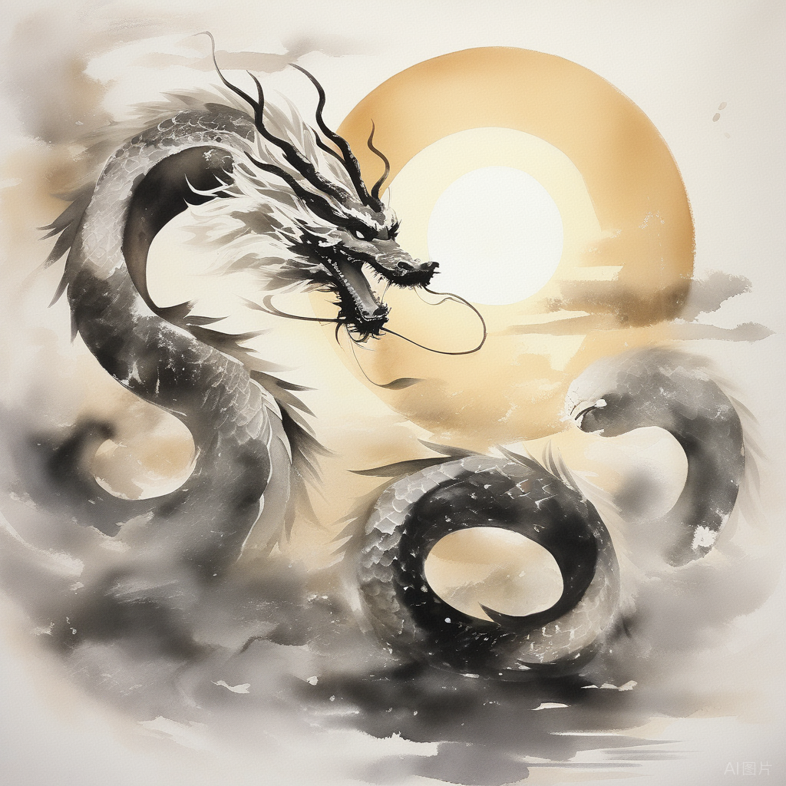

龙年已过，蛇年开始。趁春节假期，记下了24年的一些感悟。

## 1. 人是叙事的机器

2024年最大的进步是对每天做了较完整的记录。这让我有了一个有趣的发现：24年初时，我大多数时候处于一种不开心、压力大、烦躁的状态，情绪起伏不定，到了6月甚至跌至谷底，出现了抑郁的征兆；然而到24年底，我的心理健康和活力却接近近十年来的最佳状态。这种转变 **并非因为解决了那些困扰我的问题——许多问题甚至变得更糟** 了——我做的只不过是一些通过一些简单的心理调节，却实在实现了从焦虑、愤怒到平静、愉悦与从容的转变。

于是，我对“人是叙事的机器”有了很深切的体会。正如柏拉图的“黑马白马”或更流行的“象与骑象人”的比喻，人远没有自己想象的那么理性、正确或强大。我们的行为很大程度上受快乐和痛苦驱动，而这些情绪的来源在于我们需要不断被告诉自己“我很好”“我的经验很重要”“我的判断很正确”。这种动物性的存在感让我们的大脑不断虚构着模式与因果关系，即使事件之间并无实际关联，我们也会倾向于构建一个故事，从中寻找意义，支撑自己活下去。甚至“我是谁”本身就是我们讲给自己的一个故事。

过去，我认为这是人的弱点，类似于佛家所说的“我执”，是贪嗔痴慢疑的根源。人应尽量放下执着，接纳“无我”，或如斯多葛学派所言，只控制自己能控制的，顺应自然变化，以获得内心平静。但今年，我对这个问题有了更深的理解——虽然上述道理没错，但人本身就是受情绪和叙事影响的动物，活在自己编织的意义之网中，这是一个难以改变的事实。既然如此，我们为何不接纳并利用这一点呢？

那么反过来看， **“人是叙事的机器”=“人生是可编程的”** 。

在成功学研究中，我们常看到：

- 乐观的人总告诉自己：困难是暂时的，失败是偶然的，与自身能力无关。
- 实验中，正常人往往高估自己，而抑郁症患者却能准确评估自己。

反过来，这也说明

- 只要不断告诉自己“困难是暂时的”，你就能变得更乐观；
- 只要让自己悲观一些，你就能更客观地评估自己。
- 相较AI的客观理性，人自带偏见，擅长自我欺骗。但这种自我欺骗是进化的结果，是人类的优势之一。通过少量信息（数据）加上简单手段（如读书、锻炼、冥想、书写等），人能心理与信念就能受到影响，从而改变行为。

这正是因为 **人有意识而不仅是智力** 。理解并利用这种力量，无疑是人生中一项重要的技能，甚至在大部分人智力已经被AI超越的当下，是最重要的技能。

年轻时总关注“什么更正确、更理性”，比如乐观与悲观谁对、努力与躺平谁对、公平与效率谁对。这可能也是一种幼稚思维的体现，“有用”才是成年人该关注的： **关注，并且根据需要调整自己讲述给自己的故事** ，需要乐观时做乐观，在需要谨慎时做悲观；既能从过去中寻找意义，也能放下过去随时重生；既能容纳相反的想法，也能坚定投入行动。超越自我、活在当下，放得下也拿得起，这才是更完满的状态。我希望有一天能做到。

## 2. 不耐心的根本原因

今年察觉到的另一个重要变化是相比之前变得更有耐心。这可能与当爸爸及工作中花更多时间在带新人和完成基础性工作上有关。我开始愿意在没有结果甚至可能永无结果的事情上投入时间，包容各种“不符合预期”和“不完美”，这是过去很难做到的。这种行为的改变，源自我逐渐明白了人为何会缺乏耐心。

虽然我们都知道“耐心是成事的必要条件”，“怕麻烦的人会麻烦一辈子”，但面对明天见效与下个月见效的选择，大多数人毫不犹豫选择前者。知易行难的原因，我体会到三层原因：

 **1. 不合理的预期**

如果问GPT如何培养一个孩子的耐心，它会说首先要关注是否为孩子提供了安全依恋的外部环境，过度的严格奖惩或不及时的响应会让孩子习惯争取立刻的关注和马上肯定。 无论是孩子还是成年人，频繁的环境变化和压力会与内部的焦虑、完美主义倾向、低挫折容忍度共同作用，形成“我必须做xxx，否则就会失败”的潜意识。现代社会通过信息放大他人的成功，鼓励我们关注他人而非自己，进一步强化了这种高预期。

当了爸爸之后，我愈发清晰地认识到—— **“没有什么事是必须做的，只有别人告诉你应该做的事情。”** 如《园丁与木匠》中所说，培养孩子应是园丁的角色而非木匠，帮助成长而非塑造成功。 **依赖他人甚至依赖自己的努力的事情，都无法控制结果** 。我们必须与“事情发生的时间”和“失败的可能性”共处，因为它们始终是生命的一部分。

 **2. 对自己和现状的不接纳**

压力让人短视，渴求“立刻见效”，否则容易放弃。这种心态是环境剧烈变化时有助于生存的本能，但现代社会的双重PUA——被鼓励的达到期待与自我要求，让我们 **习惯了直接跳到关注“现状与结果的差距”的思维模式** ，从而陷入两难：要么安于现状躺平，要么不满现状而痛苦。

跳出这个循环，关键在于接纳自己作为过程的一部分。“理想的自己”和“尽力为此而开心”并不矛盾，“失败的结果”和“从中获得成长”也不矛盾。事实上，过程往往比结果更重要。正如养育孩子的最终结局是他们自立并离开，但我想没有父母愿意跳过这个中间过程。对于自己，我们是不是也应保持同样的态度？

 **3. 注意力和思维方式**

孩子的到来让许多过去觉得重要的事变得不那么重要，取而代之的是更多的家庭责任与社会价值。这也改变了对待问题的思维方式。

当注意力从“自我实现”“情绪感受”转向“家庭”“社会”时，思维方式也更容易从“ **解决问题”** 转变为 **“创造价值”** 。这种转变 **减少了“目标与差距”之间的张力，增加了“做了与没做”之间的张力** 。正如《最小阻力之路》所说，创造作品的冲动会形成一种持续的张力，推动我们持续行动。当注意力从导向目标和结局的“解决”转向导向过程和成长“创造”，耐心自然会随之而来。正如对于画家来说，画家用一个月创作作品的价值远高于一分钟用AI生成的作品。

成为父母让我切身感受到这种思维模式的转变，但它不仅适用于外部目标。即使目标是“自我”，例如“自我实现”，我们也可以将自己视为一幅待创作的画，而非完成目标的机器人。毕竟最终，是做事的过程而非结果，决定我们成为什么样的人。

这种转变让我意识到， **耐心并非天生的能力，而取决于你的关注是什么，注意力放在哪里** 。而这完全是可以通过接纳、调整价值观逐渐培养的。

## 3. 怎样看待“成功”

成为父母后，绕不开的一件事儿是得思考孩子未来一定会问的问题， **“什么是成功，如何成功”** 肯定是其中一个。

大学毕业近十年，看到人与人之间的差距逐渐拉开，我虽算不上成功，但通过观察和社会经验，对这个问题也有了一些思考。

首先，成功是一个有明确答案的问题。关于成功的研究汗牛充栋，阿尔贝西、巴拉巴西、格拉德维尔等学者通过科学量化论证了“成功第一靠运气”“成功是成功之母”等观点。此外，内驱力、执行力、学习能力、环境因素、创造力等也被广泛研究。观察身边的人，成功者往往在这些方面表现优异，但反过来，表现优异并不一定意味着成功。

那么怎么回答孩子呢，我的答案可能会是这样的：

**1. 社会意义的成功往往意味着与大多数人不同且恰好正确**

成功是 **少数人的游戏** ：如果大多数人都正确，那么正确本身就没有价值。社会层面的成功从定义上就是属于少数人的，因为大部分事情的最大奖励往往只给少数人。 **而“正确”大多靠运气，少数靠判断力** 。

成功需要做 **难而正确的事** ：大多数成功者做过一些难而正确、大部分人不会做的事情。比如，他们不受情绪左右，能坚持到底，更关注自己而非他人。

 **2. 成功很难**

和大多数人做一样的事，结果只能是平庸；和大多数人做不同的事，大概率会失败，只有少数人会成功。

除去运气外 **，成功的过程难在往往伴随着自我否定。**

人是擅长自我欺骗的动物，大脑有一种自我保护机制叫“认知失调”——当我们的自我叙事被否定时，会感到压力、焦虑和不安，倾向于修改对现实的解读以保护自我。 例如，当我们干了一件蠢事，一个选项是推翻自己认为的“我不蠢”，一个选项是承认“这很蠢”；前者往往需要很大的心力和情绪拉扯，我更倾向于修订后者为“这是偶尔的”“这不是我的锅” 坦诚的讲，这种事情可能天天发生，因为他发生在我的潜意识，是下意识的行为。

而一个人要成长，必然经历打破现有认知，正视失败，放弃逃避的过程。这件事难在两个地方

- 第一是 **正确归因本身很难** 。张一鸣讲“要正确归因，不把外因当内因”，但公司里所见所闻，真正客观复盘的人并不多。绝大多数见到的，不是客观记录决策过程，而是根据结果写一个故事，把“过程串起来”去汇报。那么这个过程中丢失的客观，被normalize的部分有多少，可想而知
- 第二是“ **否定自己”确实是很反人性的行为** 。人总是会感觉“不甘心”“不公平”，总是需要觉得“我不错”，总是害怕失败、丢人、负面评价，这是很难改变的。但正因为大部分人的做法是选择「舒适」而非追求卓越，要成功就比如要经常性打破自己再重建。如果能做到，运气之外的其他因素，也都是可以习得的。

 **3. 真正的成功是成为你自己**

那么，还要追求所谓成功吗？

首先，那些“成功”的人就一定更加幸福吗？我想不是的，但他们的确更能接受失败和负面评价。一些人天生对特立独行和他人评价不敏感（如马斯克），而另一些人则通过后天的心态调整，比如“成长型思维”（growth mindset），将注意力放在过程、努力和进步上，从而减少负反馈的冲击。

**但成长型思维并非完美的答案或万灵解药。** 现实是，努力并不总是带来结果，过于关注努力本身可能陷入“不合理高期待”的陷阱。也许更好的方式是找到自己的兴趣，从感兴趣的事情做起，会容易些。

所以答案是，追求“舒适”和“与大多数人一样”并非错误。甚至在AI时代，追求超出AI的卓越在许多领域已不再可能。但同时， **“与大多数人一样”也可能意味着“无聊”，而少有人走的路虽然崎岖，却可能风景更多。最终，一切取决于你想清楚自己想要什么，而非盲目追求社会定义的“成功”。** 因为 **真正的成功只有一个定义，那就是成为你自己。**

## 4. 激发大于赋能，愿力大于能力

今年关于教育的阅读和对自己经历的回顾还有一个收获： **激发比赋能重要，愿力比能力重要。**

吴军在《大学之路》中提出了一个有趣的观点：评价一所大学的好坏，关键在于它是否能让学生“过得开心，并激发出一辈子学习的热情”。他提到，许多亚裔学生在中学阶段成绩优异，但进入名校后表现却不如那些因兴趣而学习的美国学生。原因在于，前者往往背负着家庭和社会的期望，而后者则因兴趣驱动，学习动力更为持久。

与许多同龄人相比， **我最感激父母的一点是，他们从未对我施加过高的期望** 。观察身边许多背负期望的人，要么需要很长时间才能从这种压力中解脱，要么早早退出了自己的“竞技场”。而我虽然算不上成功，但从未感到特别费力，大部分事情都顺其自然，唯一的挑战是不断打磨自己。这种自主感让我能够自由选择职业方向，比如从金融转向更感兴趣的行业，而不必担心他人的看法或“失败后不如从前”的恐惧。

那么除了压力之外，是什么驱动我一直有目标，并愿意为之努力？答案可能是那些 **被激发的瞬间** 。无论是通过学校、伙伴、书本还是网络， **总有那么一些时刻，人会遇见某些与自己现状不同、却令人向往的人或事** 。这些零散的信息激发了我做出一个个重要决策——从申请美国学校，到进入高盛，再到回国发展。人生目标一直在变化，但变化的动力并非“我能做什么”，而是“我想成为什么”。 **人生的过程，就是一系列“成为”。书本上的知识或许早已遗忘，但那些“原来人还可以这样活”的惊叹却永远留在了心中** 。

然而，这种激发在我的教育过程中，尤其是家庭教育中，是相对缺乏的。 **父母的优点是没有对我施加过高期望，但缺点是他们自己也缺乏明确的目标。** 我们从未一起认真讨论过我想做什么，或他们自己在做什么，为什么做，想做什么。（唯一关于未来的讨论就是一句“你以后想不想当大夫”）这导致我在“自我决定理论（Self-Determination Theory）”的三个维度中“自主感”较强，但“能力感”和“关系感”较弱： **虽然我能为自己设定并完成目标，但我一直缺乏从过程中获得兴趣的能力，这也导致了我对过程的急躁和不耐心。**

相比之下，吴军、李飞飞们的父母虽然自己并未取得社会意义巨大成就，但他们 **终身学习，拥有强烈的兴趣，并支持和鼓励孩子发现兴趣、自主选择，这很大程度上才是对下一代真正的托举** 。正如吴军所写：“书本的内容可以早学，也可以晚学，但错过了成长阶段却是无法弥补的。”在中国的好学校里，许多孩子花在读书上的时间远超吴军当年，但真正在有建树的超越他的人却寥寥无几。

在职场上，这一道理同样适用。控制型的老板往往走不远，而那些能够看见他人、激发他人、甚至与员工共同成长的人，才能走得更远。尤其是在中国职场，有能力的人很多，但知道自己想要什么、有强烈愿力去实现目标的人却相对稀缺。借用罗振宇所说的 **“愿力 \> 业力 \> 能力”——**  **愿力是驱动行动的核心，而能力只是实现目标的工具。**

做父母是一次“育儿育己”的机会。教育孩子不仅是传授知识和技能，更是通过激发他们的兴趣，帮助他们，也帮助找到愿力，一起成长，看见孩子，也看见自己。

## 5. 成长即自由

最后一个感悟，成长等于自由，这包含两层意思。

1. **成长带来更多选择，自由则为成长提供探索和试错的空间**

2024年，世界依然变化迅速，相较于关注具体的变化和趋势，我几件事体会更深

一是100%的安全感并不存在，反而暗藏风险。大环境不佳时，多数打工人会降低风险偏好，格外珍惜稳定岗位。然而，这样一来，供给增多而岗位减少，淘汰年龄大、身体差员工的力度只会比以前更大。“稳定”只是把黑天鹅换成灰犀牛，而灰犀牛说不定更危险。

二是有限游戏终会结束，无限游戏需不断创造。有限游戏无论成功或失败，都有尽头，比如晋升，金字塔式的晋升路径有其极限。而无限游戏需要不断开拓新空间，玩无限游戏就是成长，像创业、换赛道等，都需要想象力和冒险精神。绝对“安全”的无限游戏不存在，但只要能存活下去，无限游戏反而更安全。

所以 唯一对冲危机感和风险的，只有成长。停止成长的一刻，也是丧失自由的开始

**2. 自由意味等于不断解放自己，这种解放通过成长而来**

**人是经验的产物，成长就是不断否定过去的信念。否定信念的同时，也意味着看清并否定很多既定规则，否定那些“我必须”“我只能”，从而发现新的选择**

以耐心为例，上面说的“解决问题”的思维，因为我们从小就被家庭和社会灌输这种模式：“考上大学就好了”“找到对象就好了”“结婚就好了”“有孩子就好了”“孩子长大就好了”。 **大家都希望事情快点结束，看到结果，进入他们臆想的世界。** 但当你看到有少部分人是在玩无限游戏，把人生中的事当作里程碑时，面对许多事就不再必须是“我必须赢”“问题必须解决”；面对选择，也不再是“这个选择之后，我过往的能力能否用得上”，而是“这个选择之后，我能获得什么新能力”。 **这样会多一些变量，多一些自由。**

另一个例子是， **“我现在做的事不喜欢，才会出现各种问题”“现在工作的人/相处的人不行，我很难受”，这是过去人生的常态** 。起初，选项似乎只有换、忍，可能再加上抱怨。但当看明白一些后，会发现“不喜欢”“不爽”其实取决于我们是否把注意力放在他人身上，于是就有了“忽略”“课题分离”的选项。再深入一些，有些事可能是因为自己能力不足，那么可选择“成长”；有些事是因为承受力不够，而承受力不足90%源于自己的叙事——说话过程是大脑重塑的过程，越认为难承受就越难受。于是，类似“只要态度不滑坡，办法总比困难多”从一句口号变成了可操作的选项，困难变成了成长的机会。

记得五年前冬天，工作不久时，和朋友聊到“人生追求什么”，我的答案是“自由”。朋友问什么是自由，我当时也说不好，但觉得它不是拥有什么，而是达到某种状态，类似《老人与海》中的圣地亚哥，虽一无所获，但精神自由。现在，我对这种自由的理解更清晰了： **人生如逆旅，我亦是行人，对外界波澜起伏接纳且勇敢，对内心深邃变化好奇且平静，需要的只有不断前行。**
