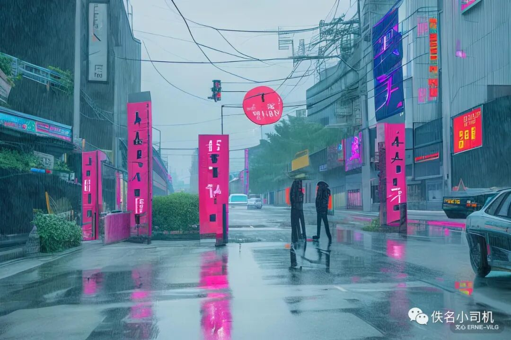

My WeChat official account had lain fallow for nearly a year. I wrote a few things here and there in between, but never posted them because they were unfinished or some of the content was unsuitable. I never expected that, chatting over the Spring Festival, a few friends would ask, “Where is your little essay this year?” So I am writing a few words for those friends and for my family. (I also hope to be more diligent this year.)

## What Changes and What Does Not

How much three years of the pandemic have changed, I think no single article can fully tell. Perhaps, like me, you went through lockdowns, changes at work, the death of family members, fevers and the scramble for medicine, yet your life stayed fairly steady; perhaps you had it harder than I did—a fresh graduate whose offer was cut down, a graduate who had to graduate all over again, a worker bracing against the cold, forced to face even greater challenges. For you and me, and even for people caught in the war restarted in 2022, the sinking economy and frequent natural disasters, history will in the end blur in memory. To borrow a line from Ms. Tang Ya, “**When the blizzard has passed, people no longer remember how they got through it, are not even sure the storm is over, but they all know they are no longer the person who walked into it.**”

Compared with past years, for 2022 into 2023 there is not much point in looking back at what happened and sorting out the logic to deduce future trends; what is more worth worrying about is looking forward. And looking forward, what I feel more personally than ever is Dalio’s line: “**The times ahead will be radically different from those we’ve experienced in our lifetimes, though similar to many times in history.**” (*"The times ahead will be radically different from those we’ve experienced in our lifetimes, though similar to many times in history."*)

### Macro

Of the expectations we hold about the future, and the recent experience we rely on to make decisions, which no longer hold? A few glimpses of the whole through a tube:

- “**Globalization is almost dead**” (*"Globalization is almost dead"*), said Morris Chang in his December speech at the opening ceremony of TSMC’s Arizona fab.
    - On globalization, scholars and statesmen of every stripe have their own insights. But for this person to say this at this place and time reflects, to some extent, the reality of the world we are in. I do not think globalization is entirely reversible (even during the Cold War, globalization grew faster than before World War I), nor that the world must return to a two-bloc structure. But from the Russia–Ukraine war to the CHIPS Act, what we see is the old global order ebbing quickly, with every country stressing security and going its own way, and international links becoming more fragile and turbulent. Companies that grew up fed by international capital and succeeded abroad are all pursuing local survival and local development (“Winning Trust”), using more redundancy and risk-management tools to control and respond to risk.
- “China’s development has entered a period in which **strategic opportunities and risks and challenges coexist** and uncertain, unpredictable factors are increasing; all kinds of ‘black swan’ and ‘gray rhino’ events may occur at any time. We must heighten our awareness of potential dangers, stick to bottom-line thinking, be prepared for danger in times of peace and plan ahead, and be ready to withstand **major tests of high winds and raging waves, even stormy seas.**” This may be the most important sentence of the 20th Party Congress. Looking ahead, “security” will become the trump card of all economic development.
    - An economic system that can circulate independently and stably even without the external circulation (at the price of some efficiency), and an independent industrial chain, are an important part of security; policy and resources will in all likelihood tilt this way.
    - For platforms that bear information-security risk (Didi), financial risk (Ant) and social risk (all of them), the era of expansion should also be over.
- “**VUCA**” (volatility, uncertainty, complexity, ambiguity) has become more and more popular in the speeches of internet and finance leaders in recent years. In such an environment, **the fragility of large systems and the tail risks brought by the inherent decision-making patterns of large organizations are growing.**
    - On the big difficulty, to quote Mr. Wan Weigang: “*The difficulty is Luo Xiang’s famous line: ‘The fundamental law is the leader’s view.’ In any large organization, people get used to the top setting a goal, middle management breaking the goal into a plan, and the grassroots executing, with coordination and assessment in between. Everyone cares about how the plan goes—as for where the goal came from, no one cares much. The problem with this kind of strategy is that you cannot face reality. If facts that do not fit the leader’s view appear along the way, people ignore the truth and cater to the leader. As we said when discussing* Hidden Games *earlier, those above and below are all deceiving themselves with partial facts. If the leader also happens to be stubborn and fights every difficulty resolutely, they will go down one road to the end. The problem is not whether the leader’s view is right. The problem is that strategy should never start from the leader’s view.*”
- Over a longer cycle, political polarization, inequality (especially the new inequality of getting rich through capital and financial means, different from the traditional “labor–capital inequality”), debt cycles, clashes of values, the tech war, demographics, natural disasters and other factors might have sounded like “needless worry” in conversations among friends a few years ago, but now talking about them with most people is a more serious conversation.
    - Many scholars compare today with the 1910s or the 1930s, and many discuss tomorrow’s China and today’s Japan and Korea. History does not repeat itself, but this also reflects the VUCA above, and that **individual fates are more easily affected by systemic shocks, so any decision may need to be considered within a more dynamic framework.**
    - Closer to home, run a simple time-series correlation between last year’s China-concept stock prices and the U.S.–China political risk premium, and look at the “platforms” that cannot get listed—many people around me who have become “free” are not laughing so easily either.

### Micro

2022 may count as a rare year in which most Chinese and American internet companies adopted an unprecedentedly uniform strategy: the four characters **“cut costs, raise efficiency”** basically covered the industry’s main priorities from the start of the year to its end. In advertising, when the economic outlook is unclear, the first thing advertisers cut is the marketing budget, as Meta’s share price shows. Companies and departments were all saying goodbye to their former selves, and for individuals, adjustments to organizational structure and business focus naturally shaped the daily work of everyone from navigator to cog. Leaders faced greater pressure to tell a good story and show good-looking results; employees felt firsthand the rapid and sharp rise of competition and “involution” in a closed (or slowing-growth) system.

But to put it in a chicken-soup way, “involution” is not yet the worst case. A few common “involution” phenomena—polishing things to perfection, complicating simple things—may be inevitable in a mature company. For example, many of my colleagues now seem surprised by making slide decks and drawing diagrams, but at my previous firm (an investment bank), the manpower spent on “embroidering through the eye of a needle” was clearly much higher. Although marginal returns are diminishing, we have not yet reached the point of low-level repetition with no increment. A macro example: in the U.S., Amazon charges a commission of 8%–15%, while opening a store on Taobao requires no commission. While Alibaba’s share of e-commerce fell from 75% in 2015 to 52%, Chinese consumers can also buy cheaper and better goods from Meituan, Kuaishou, Douyin and Tencent. For companies, the fighting strength forged in brutal competition shows in last year’s Temu and in the competition in livestream e-commerce (Douyin is now China’s highest-monetization platform).

For individuals, **if so-called “involution” is the inevitable result once rapid development reaches a state of steady development, then being able to do good work against the wind is also a capability necessary for survival.** When growth slows, some deep and demanding projects actually get more resources. Looking back this year, on the product side, closed-loop commercial monetization, connecting data across all domains, splitting and merging different product modules, finer and more scientific marketing, and intelligent, automated risk control are exactly the projects the market watches and invests in when the wind is against us. On the technology side, to quote one leader, even for advertising, which has already reached first place in China, the current technical level is only “forty points,” with plenty of room to move toward “eighty points.” Without leap-forward new technologies, with new users no longer growing sharply, the pressure for technical iteration and new commercial scenarios is greater. The professional strength and judgment required to “go deep” and “get it right” and to reduce wasted effort are clearly higher than in good times, and in such an environment, if it truly trains oneself (which requires spending more time and energy on summarizing and learning), it is not necessarily a bad thing.

The point I worry about is actually the same as last year: that an open network becoming more closed will fix relative positions in the power-law distribution for good, and **a balance tilted too far toward involution will make individual abilities overly specialized and dependent on the organization.** We have not reached that point, and in 2023 the environment facing the platform economy will be somewhat better, but this is a risk to examine and prepare for at all times. Looking back, when I chose the internet, my expectation was that in an open, fiercely competitive system I could reduce the uncertainty I faced right after returning to China (choosing, with high probability, an environment where ability speaks and path dependence is small), and further that I could learn things and gain recognition and growth through ability. These expectations have basically been met; I have basically reached roughly the top 25% in a small group of 200 and gained some internal and external recognition. But on closer inspection, my current work and results do depend to a large extent on the environment and the organization, and much of the energy I spend goes to coordinating, pushing and judging (all meetings). At year-end I chose an opportunity to join a new business, giving up short-term gains such as an imminent promotion and raise. Whether it will bring long-term returns is hard to say, but for now it also lets me **reduce dependence on the environment, put more energy into thinking about and working on projects of overall scope**, and **add a little robustness**, to give myself a bit of chicken soup.

I remember hearing Zhang Yiming say when I joined that Coase’s insight into transaction costs inspired him to think about the boundaries of organizations from the angle of transaction costs. Now, as globalization ebbs, for a fairly long period we may face a time of slower flow, shifting trade-offs between security, resilience and efficiency, and scarcer consensus and expectations, which may raise hidden transaction costs. Getting bigger may no longer mean getting stronger, “small and beautiful” and “big and comprehensive” organizations may both become directions of organizational development, and an individual’s dependence on platforms and growth will become less reliable too. The requirement of being able to **manage and run oneself** may be more urgent than the requirement of being able to manage others.

### The Constants Within Change

More critical than “what will change” is **“what will not change.”** After all that has been said, the way to respond is still not to stray too far from the slow variables. The ones most relevant to me:

***Digitalization***

Counting from deep learning, the trend toward intelligence and digitalization has lasted ten years. From 5G and cloud-edge intelligence in earlier years to this year’s AI for Science, privacy computing and AIGC, and even Web3, brain–computer interfaces and quantum computing, whose prospects are not yet clear, what has not changed (especially when certainty is scarce) is an ever deeper consensus about the digital future; what may have changed is how near or far the landing points, which were uncertain to begin with, are (and even whether they land within our generation).

With more and more tracking points and sensors, from the demand side to the production side, data is still growing fast. Whether data and computing power can become the “fifth factor of production” is very uncertain; but with labor costs ever higher and data costs ever lower, the effort to dig more value out of data will not stop for a long time. And as a practitioner in the field, I need to **reflect that I lack a global understanding of the big picture, the frontier, the applications and the business models related to data, and that I put too much energy into learning and polishing technical details and business details—the flaw of strategic laziness and tactical diligence.**

Chasing hot topics is easy to get lost in. In mid-2022 I spent time attending some startup talks in the American West about Web3, the metaverse and the like, and found that many founders in hot tracks faced a situation of “believers always believe, non-believers never believe,” and in the frenzy and competition were pursuing speed above all. On the contrary, some relatively simple, unfashionable businesses that could actually land were developing very steadily. I think the lesson for individuals may be that **the cost of machine learning and of processing complex information will keep falling, while in an environment of information overload the skills of systematic thinking, integrating and innovating ideas, and making products with clear and simple logic will become scarcer and more precious.** This requires individuals, **on one hand, to keep up with the trend and thread of technological progress and keep the ability to collaborate with machines; on the other, to think in a way that returns to common sense, spending more time integrating and thinking about what matters.**

***Connection and Openness***

Deeper digitalization and the spread of tools are still markedly lowering the cost of connection. For large platforms, that means new businesses in livestream e-commerce, online–offline integration and enterprise services; for individuals, the capital of collaboration and dissemination falls further, individually specialized human-capital factors more easily become “head” players in more interconnected open networks, and people in the network face the competition of crossing over at any time; employment flexibility is higher and higher, but stability is lower and lower. Work will demand more and more creativity. To quote the view in Edmund Phelps’s *Mass Flourishing* (highly recommended; hard to read, and I have read only a quarter), those who do creative work will also become the cornerstone and source of social stability, while those doing uncreative work face the risk of being eliminated. So **examining one’s work by how much innovation and creativity it contains** is necessary and urgent. In a 2022 survey of 500 domestic occupations, Ms. Tang Ya’s team gave “data scientist” a score of 100 on “creativity”; comparing that with my own daily work, I am rather abashed. I hope to do more creative projects in the future.

***Slow variables hard to reverse in the short term***

Besides the **regional cooperation, demographic change, climate and environment** discussed above, a shift in expectations and risk appetite from short-term to long-term (as in Japan) is also common in history. For ordinary people, it means both risk (financial decisions, career decisions, retirement) and opportunity (some counter-cyclical bullish industries such as pets, psychology and second-hand goods); for most people, of course, it is more of the former.

## Reading the Situation and Breaking Through

With all of the above, what is past cannot be remonstrated with; what matters is the new key questions under the new situation. I hope that by the end of 2023 I will have more complete answers to the following few questions.

**1. Among the things I have already invested in, whose premises no longer hold, which are not being executed well, and how should I adjust?**

Having gone through the many changes of 2022, one firsthand feeling is that quite a few people who seem to be going faster and to be more successful than I am do not see any farther than I do. In a few cases people can use rational thinking, and in even fewer can they carry out rational decisions; more often, everyone acts on experience and inertia. Facing a temporary cycle or fluctuation, this can even be an advantage, but if the premises of something change (in exaggerated terms, a “paradigm shift”), it may become going down one road to the end.

For example, an open, integrated, fast-moving world is the experience of our generation. From a Martian’s point of view, building globalized products is still the pursuit of many peers. Jumping from the crest of one wave to the crest of another, with fast trial and error and growth, is even more the success experience of the previous generation and of ours. Whether these will continue to hold, I cannot say; but what is certain is that the most successful business strategies and the success of the most formidable people also contain a lot of luck. **Many past plans may carry implicit experience and assumptions behind them, all of which need to be examined and adjusted, and thought through and stated clearly.**

And when one is not so sure about expectations of trends, everyone may have to answer again “who am I, what do I really want,” **put one’s own preferences into a strong ranking, and be ready to make trade-offs.** For example:

- If you are chasing waves or making new products, the current wave is in Southeast Asia, and where the next one is is hard to say; perhaps good directions cannot wait.
- If you are cultivating a field deeply and pursuing the long term, the question of ROI (return on investment) is now clearly more urgent; even if you do not ask it, others will soon ask. You need to think clearly at all times about **“what I want to do,” “whom I do it for,” “why they need it,” and “because of me, what changes about this thing.”**
- If you need to balance family and children’s education, then mobility (a word with no good Chinese equivalent), value for money and the like are also what many people will weigh more. Quite a few friends around me have gone to the Nordic countries and Canada over these three years to start families.
- If you are following the rise of a great power and pursuing dreams on the back of national fortune, then it is all the more “strategic opportunities coexisting with risks and challenges,” and individuals also need to do strategic management and risk management and cannot stand aside.

Answering the questions above of course concerns what I have, what I can do, how much I overestimate my abilities and resources, and my interests and preferences, but in essence it comes down to answering what kind of person I want to become, and striving to put it into practice.

**2. Externally, facing an unstable environment, how should I conduct myself?**

As above, when the wind is behind us, whether the boat carries people who have cultivated deeply for the long term, people who joined to speculate, people ready to jump ship at any moment, or people far-sighted and short-sighted, none of it matters; everyone can reach the destination. Burying your head in work is more reliable than looking up at the road. Goals may come earlier or later, but in the end you need not choose between them.

But in a “great change unseen in a century,” stepping back and looking over a long span of time, so-called progress, growth and equality are all new phenomena that appeared only very recently; we cannot assert that society will necessarily progress or the economy necessarily grow, and I do not believe science and democracy can solve the difficulties and challenges we now face. “**To know that one does not know is best; to not know yet think one knows is a sickness.**” (Laozi: knowing that you do not know is lofty; not knowing yet thinking you know is a disease, and the medicine must not stop.) These are words to keep in mind for a long time.

To quote the four pieces of advice for individuals in the final chapter of Dalio’s *The Changing World Order*:

1. Think through all the possibilities, consider the worst case, and then find ways to eliminate the intolerable ones.
2. Diversify risk. (Not limited to financial risk here.)
3. Delay gratification. (Make sure ability grows faster than income, and income grows faster than debt.)
4. Talk with the smart people around you, and change and adjust your views at any time.

The word the book uses throughout for facing the future is “navigate,” originally the process of sailing at sea, steering across rapids and reefs, which I find very apt. To do the four things above, one must be able to **run oneself independently in different environments: internally, organize one’s goals, strategy, methodology and resources with a clear train of thought; externally, productize one’s strengths, make them general and plug-and-play, and master the leverage and methods of personal marketing**—these are goals more important and urgent than before.

**3. Internally, how do I find and solve the key difficulties?**

I have talked about risk, about reducing dependence, about creativity; in the end, if I must name my core ability, it still comes down to **solving problems.**

Whether for career development or the ultimate bottom line of survival, what counts is whether you have solved, and can in future solve, a class of important, relevant problems. Put this way it may be too broad, covering 80% of jobs. But in reality people who think clearly are already somewhat scarce. People who can use tools and systematic thinking to **independently raise or solve important problems are rarer still.** Of what I did in the past, how much was tightening screws, how much was being a tool, how much grasped the essence—a little review makes clear how far I am from this goal.

Can this ability be improved and practiced?

One feasible shift is to make learning and work **problem-driven**, with less interest and more strategic thinking. Some things I hope to do:

1. Replace the reading list with a problem list; make progress and produce output on at least one key problem every week.
2. A complete problem solution includes:
    1. Real, objective external data or citations
    2. Others’ experience
    3. Analysis of the current state
    4. The logic and framework of the solution
    5. Methods (including methods of research, communication with others and communities, and tools I know or do not know)
    6. A complete retrospective
3. Problems can be big or small
    1. Big problems include my direction of development and resource allocation, and specific work/industry-related problems
    2. Small problems include specific questions and methodologies in study, time management and the workplace

## Closing

When I started drafting this piece I had just seen *The Wandering Earth 2*, which was indeed better than expected. But walking out of the cinema I could not help wondering: if it were in New York, could a Western audience be as moved and empathize as we did? Around this Spring Festival, the TV channels reviewed the hardships and achievements of 2022—women’s volleyball, aerospace, the Winter Olympics, the earthquake, the fight against the pandemic—and it was truly moving; but if programs with lines like “ten chopsticks cannot be broken” and “think as one, work as one” were aired by American news channels, how many people would misread them? When I was young I thought the value gap was something rather abstract, a slogan for conflicts of interest, the wealth gap and the political gap, but through the pandemic and my own growth I have come to feel firsthand that it may be more real and more important than the other gaps. Still too young, too simple, sometimes naive.

With the pandemic over, while remaining optimistic about the long term, in the short term I do agree that “we are headed for a poorer, meaner and smaller world.” (Shivshankar Menon) Compared with three years ago, every gap seems larger and mutual understanding harder. But in the face of difficulty, we can still **choose to be calm and open-minded, to keep an attitude of acceptance and openness toward what is beyond our control, while doing our best to work and live, and doing as much good as we can.** Cherish the family and friends of the present; even if we cannot be rational optimists, we can at least be active pessimists, add a little more positive energy, and keep company with the god in our hearts: “a good conscience is our only sure reward.”

**References**

- Principles for Dealing with The Changing World Order, Why nations Succeed and Fail, Ray Dalio, 2021
- China’s “Dangerous Storm” Coming: The Eight Big Challenges Facing China and the People Chosen to Deal with Them, Ray Dalio, 2022
- Tang Ya (Xiang Shuai)’s China Wealth Report (2022–2023), Tang Ya, 2022
- [2022 Startup Trend Analysis, Miracle Plus](https://mp.weixin.qq.com/s?__biz=MjM5MzE3NzE1OA==&mid=2247502272&idx=1&sn=2bd5390173c5589ff63b0686d12c8a26&scene=21#wechat_redirect)
- Leap: The Technique of Becoming a Master (《跃迁：成为高手的技术》), Gudian, 2017
- The Almanack of Naval Ravikant, Naval Ravikant
- The Long View: Career Strategies to Start Strong, Reach High, and Go Far, Brian Fetherstonhaugh, 2016
- Decisive: How to make better choices in life and work, Chip Heath & Dan Heath, 2013
- The Crux: How Leaders Become Strategists, Richard P. Rumelt, 2022
    - A retelling of *The Crux* by Wan Weigang
- Letters from Silicon Valley 3 (《硅谷来信3》), Wu Jun, 2021
    - How to overcome “involution” with vitality
    - What does involution really mean
    - How to understand “better to be the head of a chicken than the tail of an ox”
- He Fan’s Big Picture (《何帆大局观》), 2017
- [Lu Qi’s Talk: Entrepreneurial and Innovation Opportunities in the New World Landscape, Miracle Plus, 2021](https://mp.weixin.qq.com/s?__biz=MjM5MzE3NzE1OA==&mid=2247493627&idx=1&sn=3a4b3431ec36b86740add39b59488bcf&scene=21#wechat_redirect)
- [Learning Computational Advertising “Deeply”](https://mp.weixin.qq.com/s?__biz=MzU3Njc2ODczNw==&mid=2247484803&idx=1&sn=6a16fe3f2f55e5408b76a1e6794d9d23&scene=21#wechat_redirect), Wang Zhe, 2022
- [China’s Twelve Biggest Internet Companies in 2022: Saying Goodbye to Their Former Selves](https://mp.weixin.qq.com/s?__biz=MzU3Mjk1OTQ0Ng==&mid=2247498830&idx=1&sn=0f71dc6f8b47136b8c64372c5c761742&scene=21#wechat_redirect), LatePost, 2022
- [A 10,000-Character Retrospective on 2022: The Companies That Rose Against the Tide](https://mp.weixin.qq.com/s?__biz=MzI4MDUzMTc3Mg==&mid=2247579740&idx=1&sn=a3ac8d4d2670745c5472eba42c7ecc5b&scene=21#wechat_redirect), Silicon Rabbit Race, 2022
- [Top Ten Frontier Technology Trends of the Year: AIGC Market to Exceed a Trillion, Quantum Computing One Step from Landing](https://mp.weixin.qq.com/s?__biz=MzIzNjc1NzUzMw==&mid=2247661616&idx=2&sn=d410a4aabe4b7acb1c73e20a9c04a571&scene=21#wechat_redirect), QbitAI, 2022
- [DAMO Academy’s Ten Technology Trends for 2023: Humanity’s Imagination of General AI Has Never Been So Concrete](https://mp.weixin.qq.com/s?__biz=MzIzNjc1NzUzMw==&mid=2247660361&idx=1&sn=ae7ceb14ebaf02832cab6673e7e476bf&scene=21#wechat_redirect), QbitAI, 2022
